# Exploratory Data Analysis of E-Commerce Order Data (Python)

**Project 2 of the DecodeLabs Data Analytics Internship (2026).** This project uses Python to explore order data and describe useful patterns, data quality issues, and relationships.

## Project overview

Exploratory data analysis (EDA) means inspecting and summarising data before drawing conclusions. The goal here is to understand patterns, problems, and relationships in the e-commerce orders dataset.

## Dataset

The dataset contains 1,200 e-commerce orders dated from 1 Jan 2023 to 30 Jun 2025, with 14 original columns: OrderID, CustomerID, Date, Product, Quantity, UnitPrice, TotalPrice, PaymentMethod, OrderStatus, ShippingAddress, TrackingNumber, CouponCode, ReferralSource, and ItemsInCart. DecodeLabs provided the data for the internship.

The category splits are unusually even, so the data may be sample data. Findings should be treated as patterns to monitor, not proven business facts. The dataset does not state a currency.

## Tools and skills

**Tools:** Python, Pandas, NumPy, Matplotlib, Seaborn, SciPy, and Kaggle Notebook.

**Skills:** data inspection and cleaning, descriptive statistics, distribution analysis, IQR and Z-score outlier detection, trend analysis, correlation analysis, chi-square testing, and business insight writing.

## Data inspection and cleaning

| Check | Records affected | Decision |
|---|---:|---|
| Extra spaces in text | 0 | Checked as a precaution |
| Invalid dates | 0 | None found |
| Duplicate rows | 0 | None found; nothing removed |
| Quantity or UnitPrice <= 0 | 0 | None found |
| Blank CouponCode | 309 (25.75%) | Relabelled "No Coupon"; rows kept, not filled with zero |
| Helper columns | 1,200 rows | Added Year, Month, YearMonth, HasCoupon, IsCompleted |

The cleaned data has 1,200 rows and 19 columns, no missing values, and no rows were lost. The original data was kept untouched; changes were made on a copy. `TotalPrice` equals Quantity × UnitPrice in every row, so coupon discounts are not subtracted from the prices.

## Revenue note

The data has no payment or settlement records. In this analysis, “revenue” means the value of Shipped and Delivered orders. It is an estimate of money earned, not confirmed cash. No currency is stated.

## Key findings

- **497 of 1,200 orders (41.4%) were cancelled or returned**, worth 519,674 of 1,264,762 total order value. Only 466 orders (38.8%) were completed, worth 488,760. **Recommendation:** Review cancellation and return reasons before relying on order value as an indicator of completed sales.
- **237 orders (19.8%) are Pending**, including some from 2023. **Recommendation:** Check whether these older orders were completed or need their status updated.
- **Monthly completed order value is volatile.** It peaked in October 2023 at 36,899 and was lowest in September 2023 at 5,641. Average completed order value fell from 1,172 (2023) to 1,012 (2024) to 867 (2025, January to June only, 85 orders). **Recommendation:** Monitor monthly results and compare full-year periods with full-year periods.
- **Bigger carts are linked with bigger orders:** Quantity and ItemsInCart correlate at 0.65; average order value is 369 for one item and 1,743 for ten. **Recommendation:** Track cart size alongside order value in future data.
- **About 74% of orders (891) used a coupon**, but coupon orders are no larger than non-coupon orders (1,025 average without a coupon), and no discount appears in any price. **Recommendation:** Confirm whether discounts are recorded elsewhere before evaluating coupon performance.
- **Printers (82,452) and Laptops (80,952) lead completed order value; Desks are lowest (57,651).** Instagram leads referral sources (108,247). **Recommendation:** Monitor product and referral results with more complete business records.
- **Chi-square tests did not find statistically significant cancellation and return rate differences** for product (p = 0.977), payment method (p = 0.216), referral source (p = 0.612), or coupon (p = 0.232). Only referral source changes the overall status mix (p = 0.005). **Recommendation:** Treat these as leads for further checking, not proof that a group causes an outcome.
- **Eight TotalPrice outliers are above 3,330.41.** All have Quantity 5 and a high unit price. They appear genuine, so none were removed. The Z-score method found none. **Recommendation:** Keep these orders in the analysis and review unusually large orders as part of routine data checks.

## Descriptive statistics snapshot

`TotalPrice` has a mean of 1,053.97, median of 823.62, standard deviation of 819.86, and skewness of 0.89. The mean and median are close for Quantity, UnitPrice, and ItemsInCart.

## Correlation snapshot

| Variables | Pearson correlation |
|---|---:|
| UnitPrice and TotalPrice | 0.72 |
| Quantity and ItemsInCart | 0.65 |
| Quantity and TotalPrice | 0.62 |
| ItemsInCart and TotalPrice | 0.39 |
| UnitPrice and Quantity | 0.02 |

Some links with TotalPrice are built into how order totals are calculated. Correlation describes how two values vary together; it does not show that one causes the other.

## Screenshots

Images are linked from their existing locations in the repository so the original project files are left untouched.

1. Data loading, first and last rows, data types, and missing values: 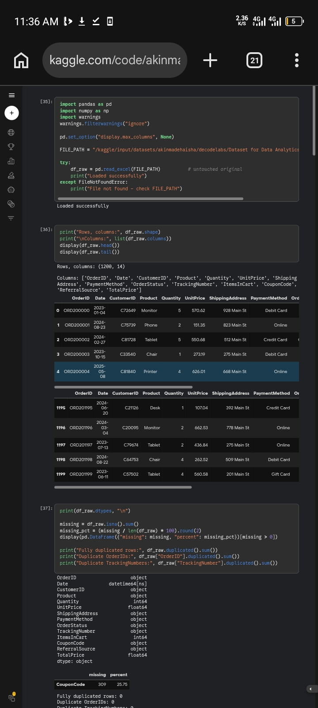
2. Category counts, date range, and validity checks: 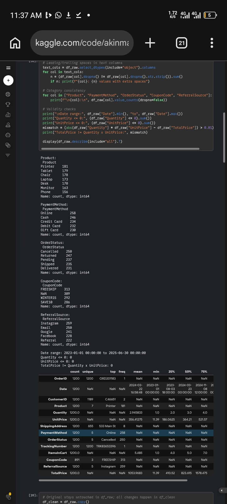
3. Descriptive statistics and category counts: 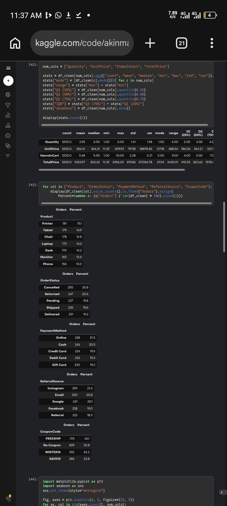
4. Histograms and boxplots: 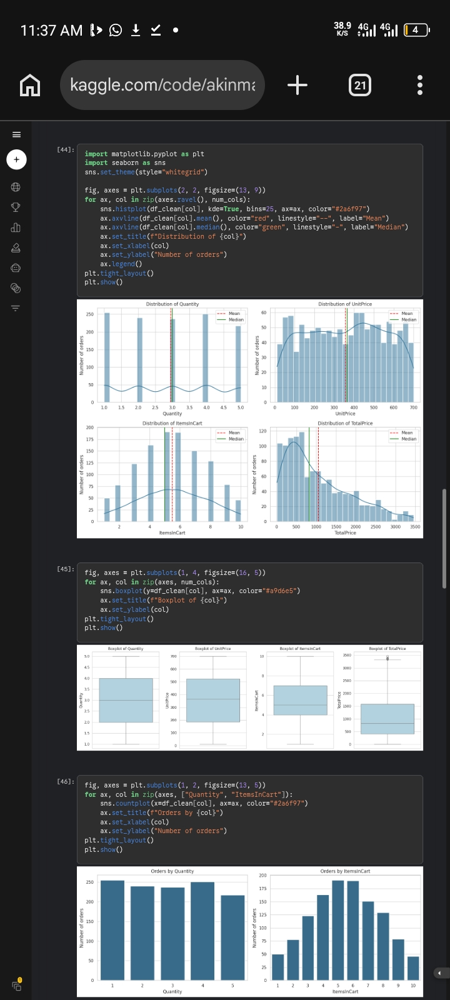
5. Quantity and cart-size charts, IQR and Z-score outlier table: 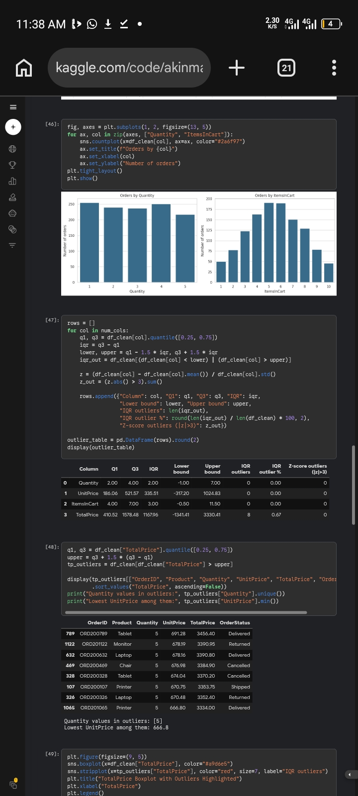
6. TotalPrice boxplot with the 8 outliers marked: 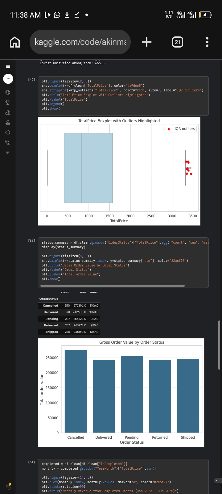
7. Order value by status and monthly completed order value: 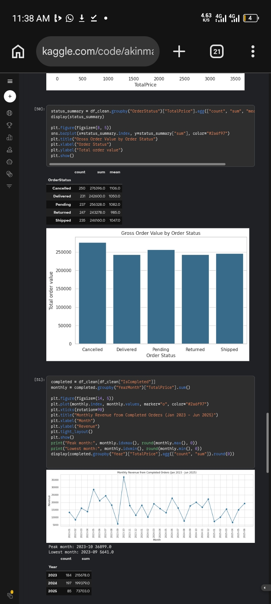
8. Revenue and cancellation rates by category: 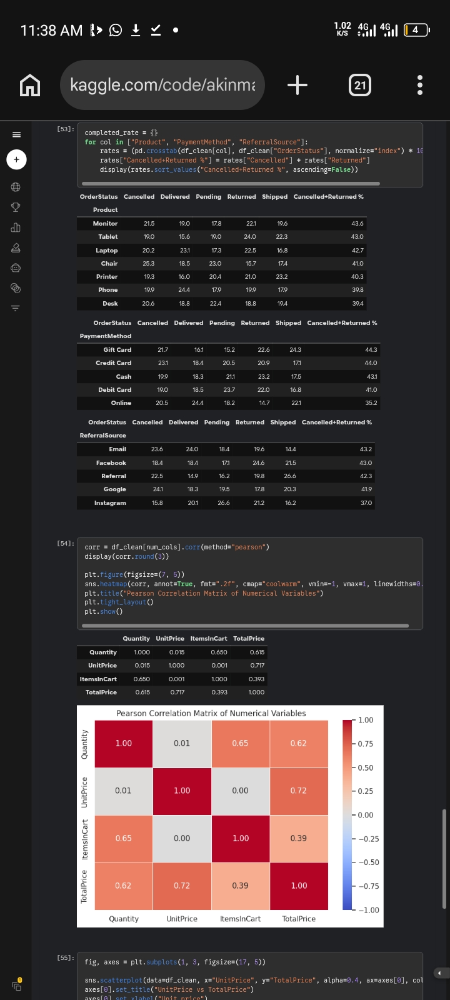
9. Correlation matrix and heatmap: 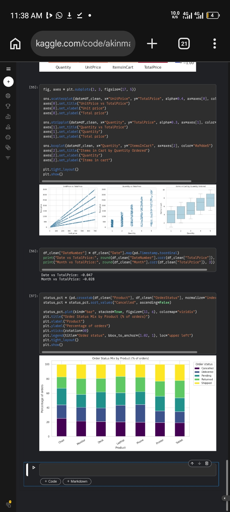
10. Scatter plots and order status mix by product: 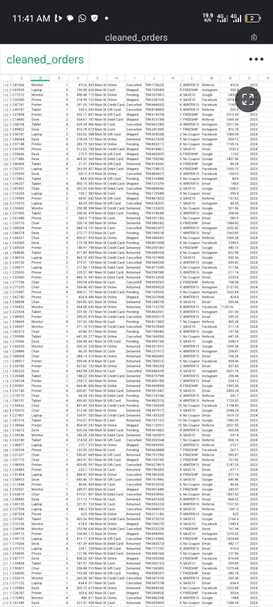
11. Cleaned CSV preview: 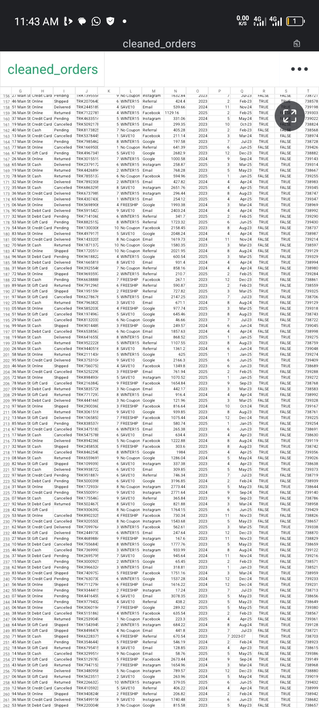
12. Cleaned CSV, more columns: 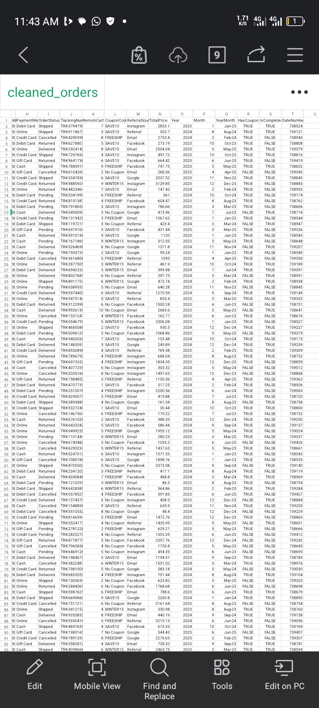
13. Outlier summary file: 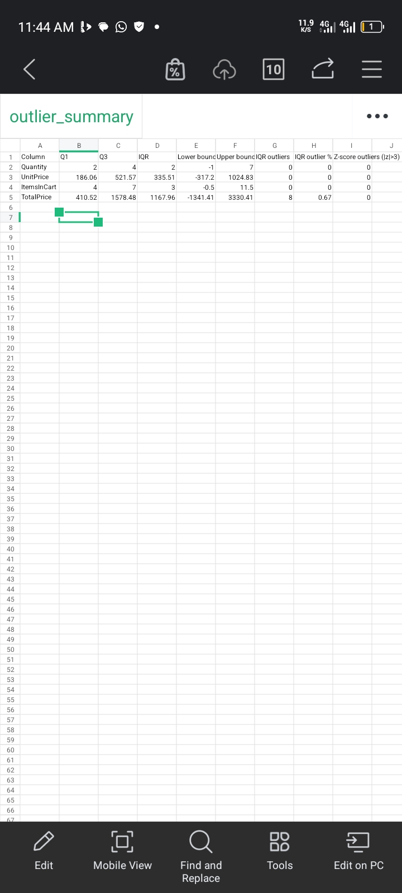

## Limitations

- There is no cost or profit data and no payment settlement data.
- There is very little customer or location detail: all shipping addresses share one street name, and only 11 customers repeat.
- 2025 covers only six months.
- Groups of roughly 60 to 120 completed orders mean small differences may be due to chance.

## How to run

Open the notebook on Kaggle or locally, install `requirements.txt`, place the Excel dataset where the notebook can find it, and run all cells. The intended setup searches `/kaggle/input` and the current folder for any `.xlsx` file.

**Source-file note:** The repository currently contains `decodelabs_data_analysis.ipynb`, not the requested `EDA_Project2_Notebook.ipynb`. The existing notebook uses a fixed `FILE_PATH` rather than searching those locations. It was not edited or re-run.

## Files in this project

| File | Description |
|---|---|
| [Notebook](../decodelabs_data_analysis.ipynb) | Existing EDA notebook in the repository; its filename differs from the requested name. |
| [Cleaned orders CSV](../cleaned_orders%20%281%29.csv) | Existing cleaned order data in the repository. |
| [Outlier summary CSV](../outlier_summary%20%281%29.csv) | Existing outlier summary in the repository. |
| [Plain-English report](../EDA_Report_DecodeLabs_Project2_Plain_English.docx) | Report provided with the project files. |
| `requirements.txt` | Python package requirements for the analysis. |

## Author

**Kofoworola Akinmade**  
Email: [akinmadek22@gmail.com](mailto:akinmadek22@gmail.com)  
LinkedIn: [akinmade-haisha](https://www.linkedin.com/in/akinmade-haisha-592612398)
